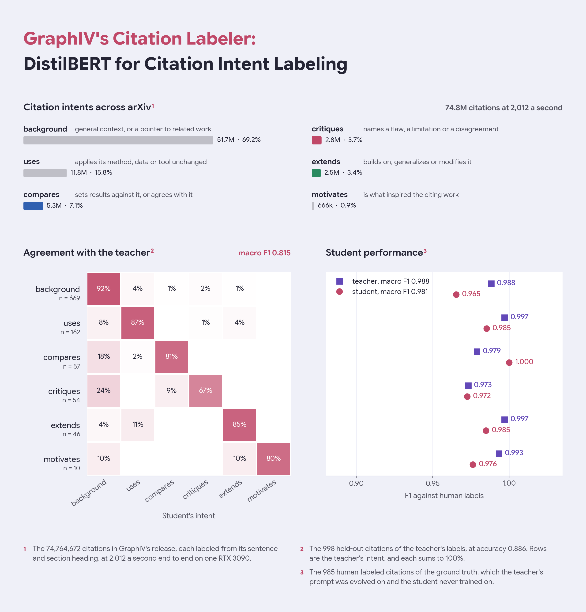
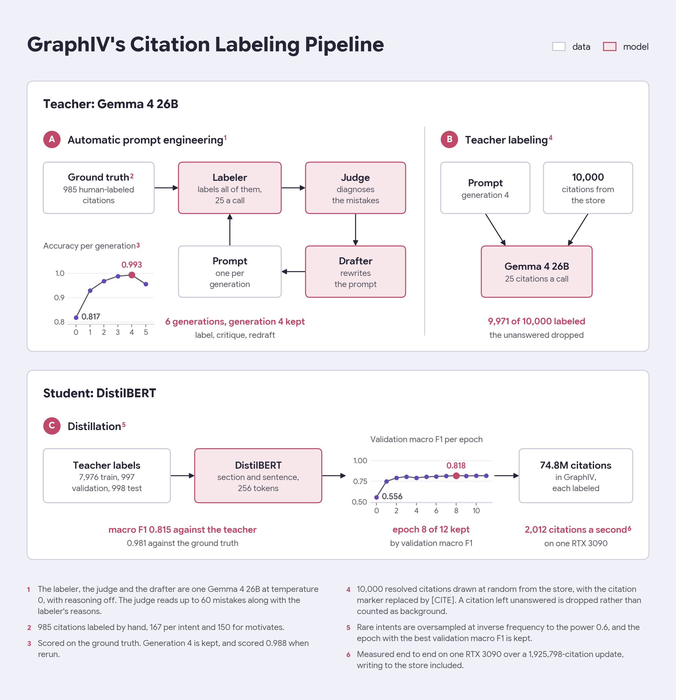

# GraphIV's Citation Labeler

This repository contains the DistilBERT model that labels why each citation in [GraphIV](https://huggingface.co/datasets/kkuroma/GraphIV) was made. No public citation intent dataset covers these six intents across all of arXiv, so this repo also explains how I made the labels while keeping the human effort small. About 1000 hand-labeled citations were enough to label 74.8M.



## Intended use

The labeler reads a citation as a pair: the heading of the section it sits in, then the sentence it sits in, with the citation being labeled written as `[CITE]`. Other citations in the sentence stay as they were written, and an empty heading is written as `(unknown)`, as in training.

```python
import torch
from transformers import AutoModelForSequenceClassification, AutoTokenizer

repo = "kkuroma/GraphIV-citation-intent"
tokenizer = AutoTokenizer.from_pretrained(repo)
model = AutoModelForSequenceClassification.from_pretrained(repo).eval()

sections = ["2 Related Work", "4.2 Implementation Details", "1 Introduction"]
sentences = [
    "However, [CITE] fails on long documents, since its attention grows quadratically with length.",
    "We use AdamW [CITE] as the optimizer with a learning rate of 1e-4.",
    "Inspired by [CITE], we propose a retrieval model that reads the citation graph.",
]
batch = tokenizer(sections, sentences, truncation=True, max_length=256, padding=True, return_tensors="pt")
with torch.no_grad():
    probs = model(**batch).logits.softmax(-1)
score, index = probs.max(-1)
for i, p in zip(index.tolist(), score.tolist()):
    print(model.config.id2label[i], f"{p:.3f}")
```

```
critiques 0.995
uses 0.996
motivates 0.994
```

| intent | the citing paper |
|---|---|
| `background` | cites it for general context, or as related work |
| `uses` | applies its method, data or tool unchanged |
| `compares` | sets its results against it, or agrees with it |
| `critiques` | names a flaw, a limitation or a disagreement |
| `extends` | builds on, generalizes or modifies it |
| `motivates` | was inspired by it |

GraphIV's `intent_score` column is the top softmax probability, as `score` above. 256 tokens is room to spare, as the longest citation in a sample of 1,962 was 205 tokens.

## Method



GraphIV labels every citation between arXiv papers. With nearly 75 million of them, the labeler has to be lightweight enough to run over all of them on a single 3090. As such, I employed a 3 tier system: human labels, a Gemma teacher, and a DistilBERT student. I then labeled the full dataset using the student. The code is in [`offline/citation_labeler`](https://git.kuroma.dev/kkuroma/graphiv/src/branch/main/scripts/citation_labeler).

### Part 1: Automatic prompt engineering

The ground truth is 985 citations labeled by hand. Gemma 4 26B labels all of them under the current prompt, 25 citations a call, at temperature 0 with reasoning off, alongside specifying the phrase that decided each label. The same model then inputs up to 60 of the mistakes as a judge, with the reasons the labeler gave, and determines which part of the prompt causes that confusion. Finally, a drafter rewrites the prompt from that diagnosis, keeping the six labels and the answer format. An answer that fails to parse counts as wrong.

| generation | 0 | 1 | 2 | 3 | 4 | 5 |
|---|---|---|---|---|---|---|
| accuracy on the ground truth | 0.817 | 0.929 | 0.968 | 0.988 | **0.993** | 0.955 |
| unparsed answers | 0 | 0 | 0 | 0 | 2 | 31 |

Only the prompt leading to the highest accuracy is kept, which can be found at [`teacher_prompt.txt`](teacher_prompt.txt) in this repo. It ranks the intents in a fixed order, so a sentence that both critiques and uses a work is labeled `critiques`.

### Part 2: Teacher-student distillation

The teacher from part 1 then labels 10,000 resolved citations drawn at random from GraphIV with that prompt. 29 failed to parse, leading to 9,971.

| intent | teacher labels |
|---|---|
| `background` | 6,834 |
| `uses` | 1,526 |
| `compares` | 642 |
| `critiques` | 452 |
| `extends` | 400 |
| `motivates` | 117 |

They are split 80/10/10 on seed 0 into 7,976 train, 997 validation and 998 test. Two thirds of them are `background`, so a sampler draws the rare intents more often while the loss stays unweighted, which keeps the balancing from being counted twice.

| setting | value |
|---|---|
| base model | `distilbert/distilbert-base-uncased` |
| input | section heading and sentence as a pair, up to 256 tokens |
| sampler | inverse class frequency to the power 0.6 |
| optimizer | AdamW, weight decay 0.01 |
| learning rate | 2e-5 peak, one cycle, peaking at 10% of the steps |
| batch | 64 |
| precision | bf16 autocast, gradients clipped at 1.0 |
| epochs | 12, keeping epoch 8 at validation macro F1 0.818 |

## Evaluation

Against the teacher, on the 998 held-out citations:

| intent | n | precision | recall | F1 |
|---|---|---|---|---|
| `background` | 669 | 0.940 | 0.918 | 0.929 |
| `uses` | 162 | 0.810 | 0.870 | 0.839 |
| `compares` | 57 | 0.793 | 0.807 | 0.800 |
| `critiques` | 54 | 0.679 | 0.667 | 0.673 |
| `extends` | 46 | 0.765 | 0.848 | 0.804 |
| `motivates` | 10 | 0.889 | 0.800 | 0.842 |
| macro | 998 | | | **0.815** |
| accuracy | | | | 0.886 |

Against human labels, on the 985 citations of the ground truth, which the student never trained on:

| intent | n | student F1 | teacher F1 |
|---|---|---|---|
| `background` | 167 | 0.965 | 0.988 |
| `uses` | 167 | 0.985 | 0.997 |
| `compares` | 167 | 1.000 | 0.979 |
| `critiques` | 167 | 0.972 | 0.973 |
| `extends` | 167 | 0.985 | 0.997 |
| `motivates` | 150 | 0.976 | 0.993 |
| macro | 985 | **0.981** | 0.988 |
| accuracy | | 0.981 | 0.988 |

The teacher's column is generation 4 rerun on the ground truth, hence the different accuracy from the figure.

On one RTX 3090, the labeler ran through a 1,925,798-citation update at 2,012 citations a second end to end, writing to the store included, so all 74.8M take about 10 hours.

## Limitations

- The labels are mostly AI-made. Humans labeled only the 985 citations of the ground truth, and the 9,971 the student learned from are Gemma 4's, so it inherits the teacher's mistakes along with its judgment.
- The ground truth is also what the prompt was evolved on, so the teacher's score on it is optimistic, and the student's 0.981 is measured against labels that prompt was tuned to.
- `critiques` is the weakest intent against the teacher, and a quarter of the teacher's critiques come out as `background`.
- `motivates` is rare, with 117 teacher labels and 10 test citations, so its scores move a lot on one citation.
- It reads one sentence, so an intent stated in the next sentence, or only clear from the whole paper, is missed.
- It was trained on English arXiv papers only.

## License

Apache 2.0, the same as DistilBERT, which it is fine-tuned from, and Gemma 4, which labeled its training data.

## Citation

```bibtex
@misc{graphiv2026,
  title={GraphIV: An Open, Reproducible Citation Knowledge Graph of arXiv},
  author={kkuroma},
  year={2026},
  howpublished={\url{https://huggingface.co/datasets/kkuroma/GraphIV}}
}
```
