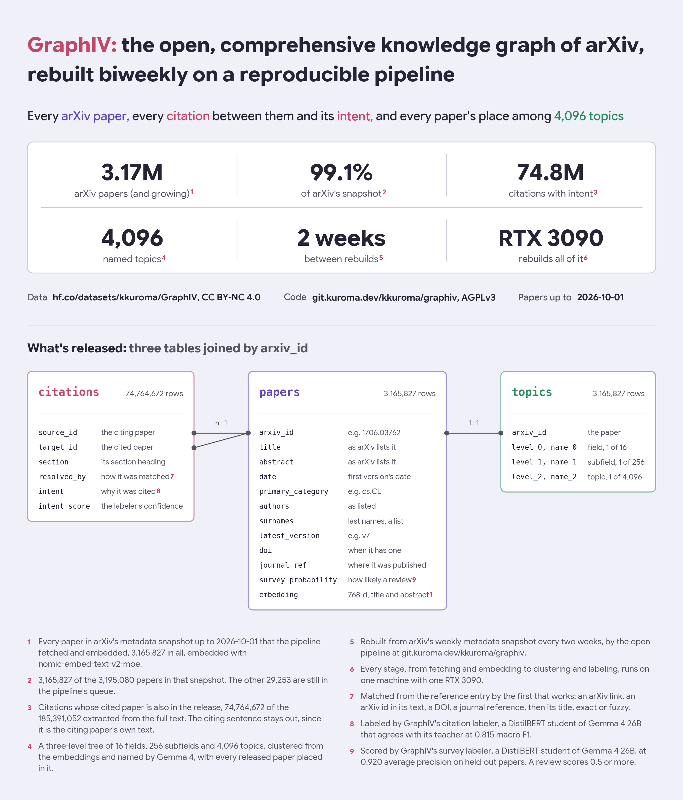
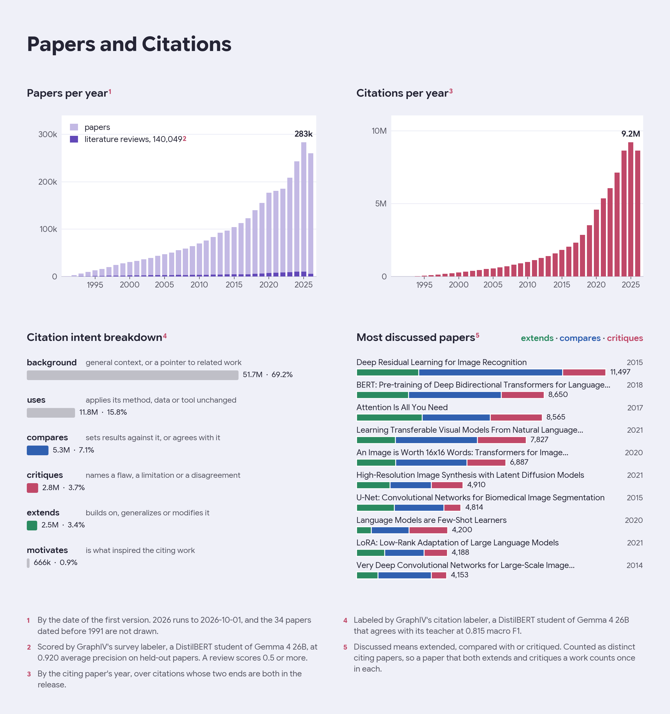
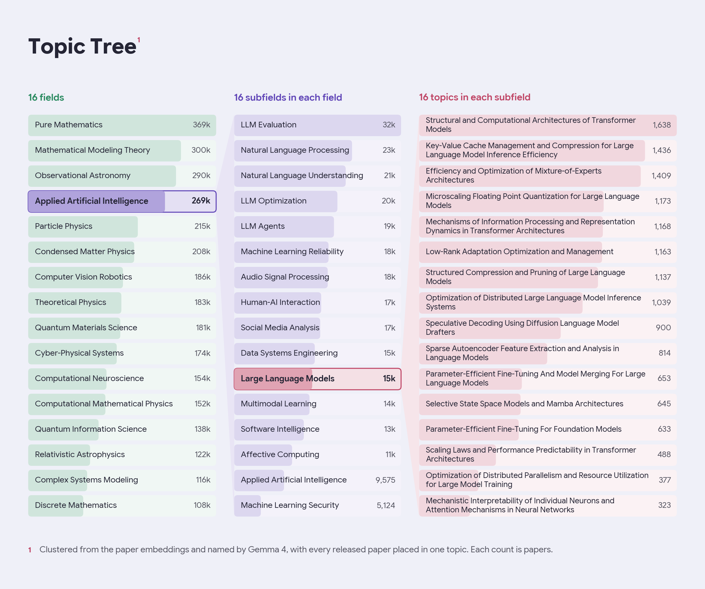

# GraphIV

GraphIV ("graph" + arXiv) is an open source, reproducible citation knowledge graph of arXiv. Rebuilt every two weeks, it is built with self-hosting in mind, as the whole pipeline runs on a single PC with a Ryzen 7 7700X, 64 GB of RAM and an RTX 3090. This repo is the database alone: three tables joined on `arxiv_id`.

| table | rows | download | one row is |
|---|---|---|---|
| `papers` | 3,165,827 | 5.3 GB | an arXiv paper with its metadata, its embedding and how likely it is a literature review |
| `citations` | 74,764,672 | 760 MB | a citation between two of those papers, and why it was made |
| `topics` | 3,165,827 | 25 MB | a paper's field, subfield and topic, in a tree of 16, 256 and 4,096 |

Each rebuild is a tag of this repo named by the date of its newest paper. The present one is `GraphIV-2026-10-01`.



## Motivation

There are tens of thousands of papers released to arXiv each month. Even narrowed down to a single topic, the count easily exceeds several hundred. For an independent researcher, the speed proved to be overwhelming, and it often left me questioning "what exactly are people doing now" in a research field.

LLM deep research tools (such as those present in Claude or ChatGPT) take upwards of 30 minutes to complete a task using extensive web search, quickly wasting tokens and often missing niche and recent publications. The closest available tool is [consensus](https://consensus.app), but even that fails to identify the absolutely newest papers, and runs on proprietary algorithms, proving difficult to scale/troubleshoot.

As such, I built GraphIV for the purpose of catching up with modern AI research using infrastructure anyone can host. My vision is to eventually unify the web of science into a singular graph database, where querying becomes a simple graph operation. Right now, arXiv is the first part that proved it can be done!

I also built an MCP server out of it, which retrieves the papers behind a question, finds the method combinations nobody has tried yet, and writes a grounded literature review. The source code is at [git.kuroma.dev/kkuroma/graphiv](https://git.kuroma.dev/kkuroma/graphiv) licensed as AGPLv3.

## Downloading GraphIV

The repo is gated behind licensing terms on this page. Accept them, then log in with `hf auth login` before downloading. Each table is a config, and `revision="GraphIV-2026-10-01"` pins a version.

```python
from datasets import load_dataset

papers = load_dataset("kkuroma/GraphIV", "papers", split="train")
citations = load_dataset("kkuroma/GraphIV", "citations", split="train")
topics = load_dataset("kkuroma/GraphIV", "topics", split="train")
```

The example below shows an example of listing all papers that critique *Attention is All You Need*, using DuckDB as joining a database this large is easier when it only reads necessary columns.

```python
import duckdb
from huggingface_hub import snapshot_download

root = snapshot_download("kkuroma/GraphIV", repo_type="dataset", allow_patterns=["papers/*", "citations/*"])
duckdb.sql(f"""
    SELECT DISTINCT p.arxiv_id, p.date, p.title
    FROM '{root}/citations/*.parquet' c
    JOIN '{root}/papers/*.parquet' p ON p.arxiv_id = c.source_id
    WHERE c.target_id = '1706.03762' AND c.intent = 'critiques'
    ORDER BY p.date DESC
    LIMIT 10
""").show()
```

### Reproducing

Due to licensing issues, I had to leave out the sentence around the citation as it contains the paper's text verbatim. To retrieve them, you'll need to extract the sentences from arXiv's own HTML files. Running the pipeline at [git.kuroma.dev/kkuroma/graphiv](https://git.kuroma.dev/kkuroma/graphiv), would rebuild the pipeline from downloading the source files and constructing this whole DB. A rebuild from scratch needs about 6 TB for the PDF and HTML full text and 90 GB for the Postgres store.

## Contents of GraphIV

| table | column | type | holds |
|---|---|---|---|
| `papers` | `arxiv_id` | string | the arXiv id, e.g. `1706.03762` |
| | `title`, `abstract` | string | as arXiv lists them, line breaks included |
| | `date` | date | the first version's date |
| | `primary_category` | string | e.g. `cs.CL` |
| | `authors` | string | the author list as arXiv lists it |
| | `surnames` | list of string | the authors' last names |
| | `latest_version` | string | e.g. `v7` |
| | `doi` | string | when it has one |
| | `journal_ref` | string | where it was published, when given |
| | `survey_probability` | float32 | how likely it is a literature review, read as one from 0.5 |
| | `embedding` | 768 float16 | nomic-embed-text-v2-moe over the title and abstract |
| `citations` | `source_id` | string | the citing paper |
| | `target_id` | string | the cited paper |
| | `section` | string | the heading of the section the citation sits in, e.g. `2 Related work` |
| | `resolved_by` | string | how the reference was matched to `target_id` |
| | `intent` | string | why it was cited, one of six |
| | `intent_score` | float32 | the labeler's softmax probability for that intent |
| `topics` | `arxiv_id` | string | the paper |
| | `level_0`, `name_0` | int16, string | its field, one of 16 |
| | `level_1`, `name_1` | int16, string | its subfield, one of 16 in that field |
| | `level_2`, `name_2` | int16, string | its topic, one of 16 in that subfield |

The embedding input is `search_document: Title: <title>\nAbstract: <abstract>`, cut at 512 tokens, so a query is embedded with the `search_query: ` prefix.

### Papers and citations



Citations are parsed from the bibliography of each paper's HTML, parsing to one row per occurrence, meaning a paper citing the same work twice results in two rows.

`resolved_by` refers to one of seven rules that matched the reference to an arXiv paper.

| `resolved_by` | matched by |
|---|---|
| `link` | an arXiv id in the reference's hyperlink |
| `text` | an arXiv id in the reference's text |
| `doi` | its DOI |
| `jref` | its journal reference, with exactly one hit |
| `title-exact` | its normalized title, with the year agreeing |
| `title-exact-noyr` | its normalized title, with the year disagreeing |
| `title-fuzzy` | a fuzzy title match |

`intent` comes from GraphIV's citation labeler, [kkuroma/GraphIV-citation-intent](https://huggingface.co/kkuroma/GraphIV-citation-intent), a DistilBERT distilled from Gemma 4 26B that predicts the citation intent from the citing sentence and its section heading.

| `intent` | meaning for the citing paper |
|---|---|
| `background` | cites it for general context, or as related work |
| `uses` | applies its method, data or tool unchanged |
| `compares` | sets its results against it, or agrees with it |
| `critiques` | names a flaw, a limitation or a disagreement |
| `extends` | builds on, generalizes or modifies it |
| `motivates` | was inspired by it |

`survey_probability` comes from GraphIV's survey labeler, [kkuroma/GraphIV-survey](https://huggingface.co/kkuroma/GraphIV-survey), a DistilBERT distilled the same way that reads the title and abstract. This allows thresholding, should the user need to filter out survey papers.

### Topic tree



I embedded each paper using [nomic-ai/nomic-embed-text-v2-moe](https://huggingface.co/nomic-ai/nomic-embed-text-v2-moe). These embeddings are then projected to 50 dimensions by a UMAP fit on 400,000 papers, then k-means splits the corpus into 16 fields, each field into 16 subfields and each subfield into 16 topics.

Gemma 4 gives a name to each topic from the 10 papers nearest its center, then each subfield and field recursively from the names under it. `level_1` and `level_2` count from 0 inside their parent, so a topic is identified by all three levels.

The tree is refit on every rebuild, meaning ids and names do not carry over between versions.

## Limitations

- GraphIV only covers arXiv for now, so references to anything outside it are dropped, keeping 74.8M of the 185.4M citations extracted.
- 555,537 papers render HTML with no bibliography, so they cite nothing in this release.
- Intents and survey probabilities are bulk predicted by small BERT models and can be wrong, and the intent labeler is scored against Gemma 4's labels, whose prompt was tuned against human ones with APE.
- Topics are k-means clusters named by an LLM, so a name may not describe all of its papers, and each paper sits in exactly one topic.

## License

CC BY-NC 4.0, free for research and other non-commercial use with credit. Academic and nonprofit research count as non-commercial, while a company's product or internal tooling counts as commercial. For commercial use, open a discussion on this repo first. The license covers what GraphIV adds, since the arXiv metadata columns are CC0 as arXiv releases them, and no full text is included.

| upstream | license | used for |
|---|---|---|
| arXiv metadata | CC0 1.0 | the paper records |
| nomic-embed-text-v2-moe | Apache 2.0 | the embeddings |
| Gemma 4 | Apache 2.0 | the topic names, and both labelers' training labels |
| DistilBERT base uncased | Apache 2.0 | both labelers |

## Citation

```bibtex
@misc{graphiv2026,
  title={GraphIV: An Open, Reproducible Citation Knowledge Graph of arXiv},
  author={kkuroma},
  year={2026},
  howpublished={\url{https://huggingface.co/datasets/kkuroma/GraphIV}}
}
```
