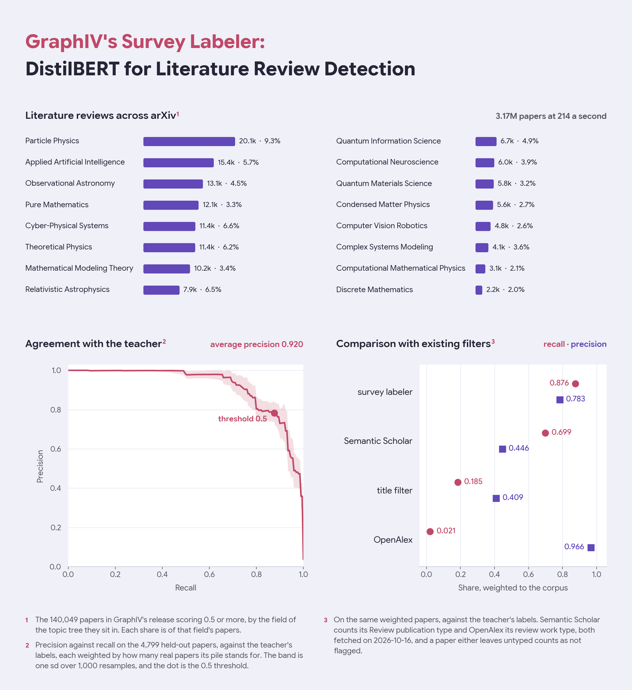
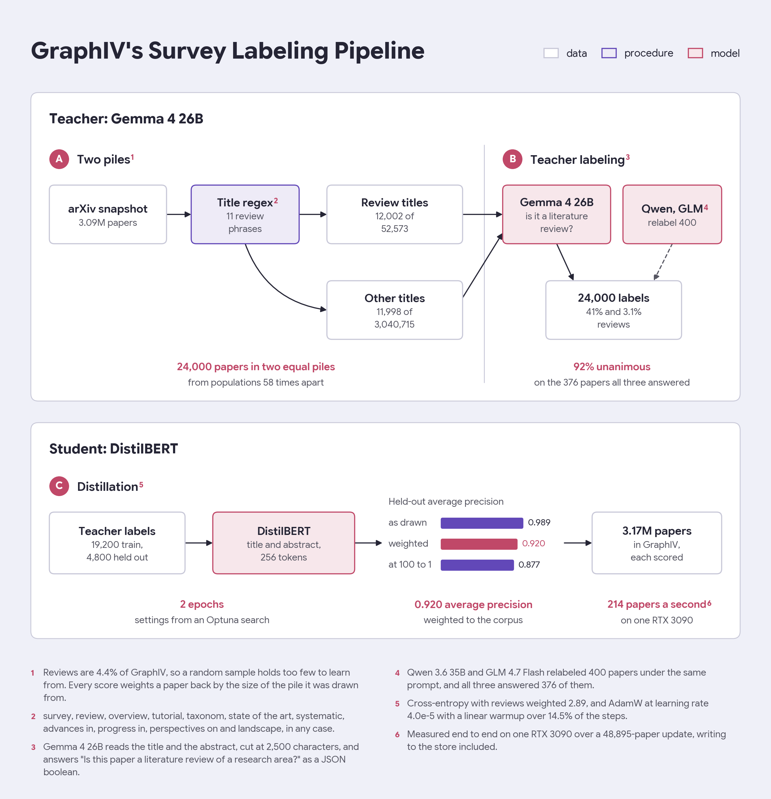

# GraphIV's Survey Labeler

This repository contains the DistilBERT model that scores how likely each paper in [GraphIV](https://huggingface.co/datasets/kkuroma/GraphIV) is a literature review. Filtering titles for words like "survey" or "review" finds fewer than one review in five, since 81% of reviews carry none of those words in their title. Reading the title and abstract instead, this labeler finds 88% of them at 78% precision, and it scored all 3.17M papers in GraphIV.



## Intended use

The labeler reads a paper's title and abstract joined by a blank line, up to 256 tokens, and outputs the probability that the paper is a literature review of a research area. GraphIV's `survey_probability` column is that probability, and a paper counts as a review from 0.5, which is the threshold every number on this card uses. Lower it to catch more reviews, or raise it for a cleaner list.

```python
import torch
from transformers import AutoModelForSequenceClassification, AutoTokenizer

repo = "kkuroma/GraphIV-survey"
tokenizer = AutoTokenizer.from_pretrained(repo)
model = AutoModelForSequenceClassification.from_pretrained(repo).eval()

papers = [
    (
        "Attention Is All You Need",
        "The dominant sequence transduction models are based on complex recurrent or convolutional"
        " neural networks in an encoder-decoder configuration. We propose a new simple network"
        " architecture, the Transformer, based solely on attention mechanisms.",
    ),
    (
        "Raman scattering in iron-based superconductors",
        "Raman scattering has been extensively applied to correlated electron systems including the"
        " new superconductors. In this review, we will give a brief summary of the existing Raman"
        " experiments in the iron-based materials and their implication for pairing mechanism.",
    ),
]
batch = tokenizer(
    [f"{title}\n\n{abstract}" for title, abstract in papers],
    truncation=True,
    max_length=256,
    padding=True,
    return_tensors="pt",
)
with torch.no_grad():
    probability = model(**batch).logits.softmax(-1)[:, 1]
for (title, _), p in zip(papers, probability.tolist()):
    print(f"{p:.3f}  {title}")
```

```
0.000  Attention Is All You Need
0.999  Raman scattering in iron-based superconductors
```

The second has no review word in its title, which is exactly the case a title filter misses.

## Method



Reviews are only 4.4% of GraphIV, so a random sample holds too few of them to learn from, and a title filter misses most of them. As such, I drew two equal piles of papers, had Gemma 4 26B label them, and distilled the labels into DistilBERT. The stage that scores GraphIV with it is [`stage4_label_survey.py`](https://git.kuroma.dev/kkuroma/graphiv/src/branch/main/scripts/papers_preprocess/stage4_label_survey.py).

### Part 1: Two piles and the teacher

The piles split the arXiv snapshot by whether the title carries one of 11 review phrases: survey, review, overview, tutorial, taxonom, state of the art, systematic, advances in, progress in, perspectives on and landscape. I drew 12,002 of the 52,573 papers with such a title and 11,998 of the other 3,040,715. Since the two piles come from populations 58 times apart, a paper from the first stands for 4.4 real papers and one from the second for 253, and every score on this card is weighted that way.

Gemma 4 26B labels each paper with one question, answered as a JSON boolean at temperature 0 with reasoning off, with the abstract cut at 2,500 characters:

```
Title: {title}

{abstract}

Is this paper a literature review of a research area?
```

I tried four longer prompts on 90 papers whose title points the wrong way, and every added instruction either did nothing or cost accuracy, so the prompt stays one question. As a check, two other model families, Qwen 3.6 35B and GLM 4.7 Flash, relabeled 400 papers under the same prompt. All three answered 376 of them and agreed on 92%, and Gemma differs from the three-way majority on 2.1%.

| pile | papers | labeled reviews |
|---|---|---|
| review word in the title | 12,002 | 4,913, 40.9% |
| no review word | 11,998 | 374, 3.1% |

### Part 2: Teacher-student distillation

The 24,000 labels are split into 19,200 train and 4,800 held out, and the split is fixed in the labeled set so every rerun scores against the same papers. DistilBERT reads the title and abstract and trains with cross-entropy, with reviews weighted 2.89 to make up for being the rarer class. The settings come from an Optuna search.

| setting | value |
|---|---|
| base model | `distilbert/distilbert-base-uncased` |
| input | title, a blank line, then the abstract, up to 256 tokens |
| epochs | 2 |
| batch | 16 |
| optimizer | AdamW, weight decay 0.012 |
| learning rate | 4.0e-5, warmed up linearly over 14.5% of the steps, then decayed linearly |
| dropout | 0.15 on the classifier |
| review weight | 2.89 |
| seed | 0 |

## Evaluation

Everything below is on the 4,799 held-out papers, against the teacher's labels.

| held-out papers | average precision |
|---|---|
| as drawn, in two equal piles | 0.989 |
| weighted back to the corpus | **0.920** |
| resampled at 100 non-reviews per review, 1,000 times | 0.877 ± 0.039 |

The weighted number is the one that describes arXiv, since the sample as drawn holds far more reviews than the corpus does.

Against existing filters, weighted the same way:

| filter | recall | precision |
|---|---|---|
| survey labeler at 0.5 | **0.876** | 0.783 |
| Semantic Scholar's `Review` type | 0.699 | 0.446 |
| title filter | 0.185 | 0.409 |
| OpenAlex's `review` type | 0.021 | 0.966 |

The labeler finds 97.6% of the reviews whose title carries a review word, and 85.3% of the 75 that do not. Semantic Scholar takes its type from a paper's published metadata, so 30% of these papers carry no type at all. OpenAlex resolves 97% of them, but types an arXiv paper by its venue, as an article or a preprint, so it calls almost none of them a review. Both were fetched on 2026-10-16.

On one RTX 3090, the labeler scored a 48,895-paper update at 214 papers a second end to end, writing to the store included, so all 3.17M papers take about 4 hours.

## Limitations

- There are no human labels at all. Every label is Gemma 4's answer to one question, so the scores here measure agreement with Gemma, and the comparison favors a model trained on its labels.
- "Literature review" is Gemma's reading of the phrase. The papers the three families split on are genre edges: a physics review of one experiment, a math survey that also proves new results, a review that adds results of its own, or an astronomy data survey written in review language.
- Only 75 held-out reviews lack a review word, yet once weighted they stand for 81% of the reviews, so recall on them carries a wide margin.
- It reads the title and abstract only, so a review that does not say so there is missed.
- It was trained on English arXiv papers only.

## License

Apache 2.0, the same as DistilBERT, which it is fine-tuned from, and Gemma 4, which labeled its training data.

## Citation

```bibtex
@misc{graphiv2026,
  title={GraphIV: An Open, Reproducible Citation Knowledge Graph of arXiv},
  author={kkuroma},
  year={2026},
  howpublished={\url{https://huggingface.co/datasets/kkuroma/GraphIV}}
}
```
